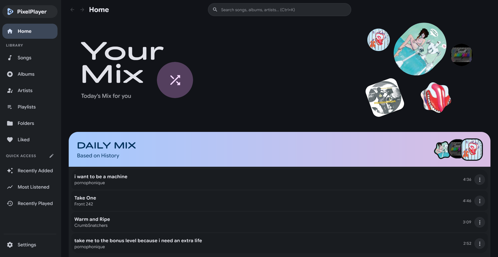
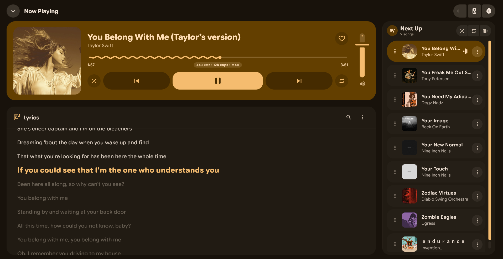
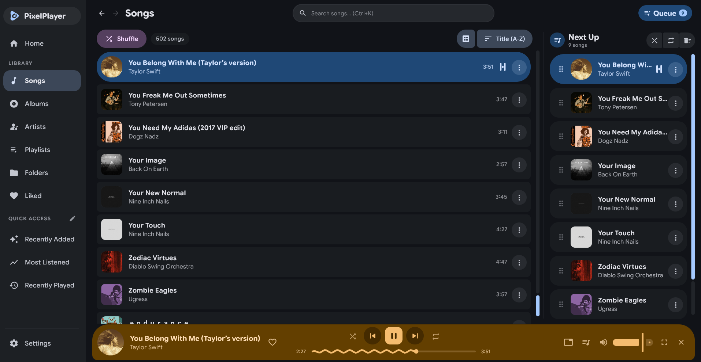

<p align="center">
  
</p>

<h1 align="center">PixelPlayer Desktop</h1>

<p align="center">
  A modern, high-fidelity local and streaming music player for Linux, macOS, and Windows, crafted with Compose Multiplatform and Material 3 Expressive design.
</p>

<p align="center">
  <a href="https://github.com/adlifarizi/PixelPlayerDesktop/releases/latest">
    
  </a>
  <a href="https://github.com/adlifarizi/PixelPlayerDesktop/releases">
    
  </a>
  
  
</p>

---

## Table of Contents

- [Overview](#overview)
- [Screenshots](#screenshots)
- [Key Features](#key-features)
- [Keyboard Shortcuts](#keyboard-shortcuts)
- [Requirements](#requirements)
- [Download & Installation](#download--installation)
- [Building from Source](#building-from-source)
- [Project Structure](#project-structure)
- [Tech Stack](#tech-stack)
- [Contributing](#contributing)
- [License & Credits](#license--credits)

---

## Overview

**PixelPlayer Desktop** brings the expressive Material 3 (Material You) music experience from mobile to desktop environments. It focuses on high-fidelity offline audio playback, seamless local library management, streaming server synchronization, and an intuitive desktop workflow.

- **Offline-First & Private**: Works completely offline with zero telemetry and no proprietary lock-in.
- **Native Audio Performance**: Low-latency, gapless audio playback powered by `libmpv`.
- **Dynamic Theming**: Fluid Material 3 interface that adapts dynamically to your album art or system accent color.
- **Package Identifier**: `com.kayoi.pixelplayerdesktop`

---

## Screenshots

<p align="center">
  <a href="assets/screenshot1.png">
    
  </a>
  <br/>
  <em>Home view with personalized mixes, quick access navigation, and recommendations</em>
</p>

<br/>

<p align="center">
  <a href="assets/screenshot2.png">
    
  </a>
  <br/>
  <em>Now Playing view featuring dynamic Material 3 color extraction, waveform seeker, and synchronized lyrics</em>
</p>

<br/>

<p align="center">
  <a href="assets/screenshot3.png">
    
  </a>
  <br/>
  <em>Library view with track browser, persistent bottom player bar, and responsive side queue panel</em>
</p>

---

## Key Features

| Category | Highlights |
| --- | --- |
| **Audio & Playback** | `libmpv` engine, true crossfade, 10-band graphic equalizer with presets and preamp, ReplayGain (volume normalization), sleep timer, queue management, and shuffle/repeat modes |
| **Format Support** | Native decoding for FLAC, MP3, WAV, OGG Vorbis, AAC, M4A, Opus, and ALAC |
| **Library Management** | Recursive folder scanner with multi-directory and exclusion support, fast SQLite caching, Songs, Albums, Artists, Folder tree explorer, Playlists, Favorites, and Daily Mix |
| **Cloud & Streaming** | Account integration with Subsonic / Navidrome and Jellyfin music servers, plus ListenBrainz scrobbling support |
| **Metadata & Tagging** | Single and batch ID3 tag editor (Jaudiotagger), online metadata and cover art fetching via MusicBrainz, multi-artist delimiter parsing |
| **Interactive Lyrics** | Embedded and synced LRC support, real-time sync offset adjustment, interactive line-by-line jumping, online lyrics search via LRCLIB, file import/export, and romanization (Pinyin, Romaji, Furigana, Hangul) |
| **Expressive Theming** | Material 3 dynamic color extraction with customizable palette styles (Vibrant, Expressive, Muted, etc.), light and dark modes, and compact sidebar option |
| **Desktop Experience** | Native OS window frame (snapping, tiling, edge resize), themed title bar, system media key / MPRIS integration, responsive queue side panel, mini player bar, and fullscreen expanded view |

---

## Keyboard Shortcuts

PixelPlayer Desktop includes full keyboard navigation for seamless playback and interface control. You can press <kbd>Ctrl</kbd> + <kbd>/</kbd> (or <kbd>⌘</kbd> + <kbd>/</kbd> on macOS) or <kbd>F1</kbd> anywhere inside the app to view the in-app cheatsheet dialog. On macOS, <kbd>⌘ Command</kbd> replaces <kbd>Ctrl</kbd> for all playback and navigation hotkeys.

| Action | Shortcut |
| --- | --- |
| **Play / Pause** | <kbd>Space</kbd> |
| **Next Track** | <kbd>Ctrl</kbd> + <kbd>→</kbd> |
| **Previous Track** | <kbd>Ctrl</kbd> + <kbd>←</kbd> |
| **Seek Forward (+5s)** | <kbd>→</kbd> |
| **Seek Backward (-5s)** | <kbd>←</kbd> |
| **Volume Up (+5%)** | <kbd>Ctrl</kbd> + <kbd>↑</kbd> |
| **Volume Down (-5%)** | <kbd>Ctrl</kbd> + <kbd>↓</kbd> |
| **Mute / Unmute** | <kbd>M</kbd> |
| **Toggle Shuffle** | <kbd>Ctrl</kbd> + <kbd>S</kbd> |
| **Cycle Repeat Mode** | <kbd>Ctrl</kbd> + <kbd>R</kbd> |
| **Favorite Track** | <kbd>L</kbd> |
| **Search Library** | <kbd>Ctrl</kbd> + <kbd>K</kbd> |
| **Toggle Queue Panel** | <kbd>Ctrl</kbd> + <kbd>Q</kbd> or <kbd>Alt</kbd> + <kbd>Q</kbd> |
| **Toggle Fullscreen** | <kbd>F11</kbd> |
| **Navigate Back** | <kbd>Alt</kbd> + <kbd>←</kbd> or <kbd>Esc</kbd> |
| **Navigate Forward** | <kbd>Alt</kbd> + <kbd>→</kbd> |
| **Shortcuts Cheatsheet** | <kbd>Ctrl</kbd> + <kbd>/</kbd> or <kbd>F1</kbd> |

---

## Requirements

| Requirement | Details |
| --- | --- |
| **Operating System** | macOS 12+ (Apple Silicon & Intel), Linux (Ubuntu, Fedora, Arch, etc.), or Windows 10/11 (64-bit) |
| **macOS Runtime** | `libmpv` is bundled into release packages or resolved via Homebrew (`brew install mpv`) |
| **Windows Runtime** | `libmpv` is automatically bundled in release installers and portable archives. No separate installation required. |
| **Linux Runtime** | `libmpv` runtime libraries (`sudo apt install libmpv2 mpv` on Debian/Ubuntu, `sudo dnf install mpv-libs` on Fedora, or distro equivalent) |
| **Build Toolchain** | JDK 21 (for building from source) |

---

## Download & Installation

Pre-built binaries and release installers are available on the [GitHub Releases page](https://github.com/adlifarizi/PixelPlayerDesktop/releases):

- **macOS**:
  - Installer: `.dmg` drag-and-drop installer.
  - Portable: `.tar.gz` archive (`PixelPlayer.app`).
- **Windows**:
  - Installer: `.exe` setup package.
  - Portable: `.zip` archive (extract and launch `PixelPlayer.exe`).
- **Linux**:
  - Debian/Ubuntu: `.deb` package (`sudo dpkg -i pixelplayer-desktop_*.deb`).
  - Fedora/RHEL/openSUSE: `.rpm` package (`sudo dnf install ./pixelplayer-*.rpm`).
  - Portable: `.tar.gz` archive.

---

## Building from Source

Clone the repository:

```sh
git clone https://github.com/adlifarizi/PixelPlayerDesktop.git
cd PixelPlayerDesktop
```

Run in development mode:

```sh
./gradlew run
```

Build portable unpacked binary (for current OS):

```sh
./gradlew createDistributable
```

Build Debian installer package (`.deb`):

```sh
./gradlew packageDeb
```

Build RPM installer package (`.rpm`):

```sh
./gradlew packageRpm
```

Build macOS disk image (`.dmg` on a macOS host):

```sh
./gradlew packageDmg
```

Build Windows installer (`.exe` on a Windows host):

```cmd
gradlew.bat packageExe
```

Run unit tests and verification suite:

```sh
./gradlew test
```

---

## Project Structure

```text
src/main/kotlin/
├── Main.kt                                    # Desktop window entrypoint, hotkey router, and life-cycle
└── com/kayoi/pixelplayerdesktop/
    ├── cli/                                   # Standalone CLI diagnostic runner
    ├── data/                                  # SQLite database, DAOs, repositories, audio scanner, libmpv engine, preferences
    ├── di/                                    # Koin dependency injection configuration
    ├── domain/                                # Core domain models, contracts, and repository interfaces
    ├── platform/                              # Windows media key session and Linux MPRIS integration
    ├── presentation/
    │   ├── components/                        # Reusable Compose UI components, dialogs, player controls
    │   ├── navigation/                        # Back-stack dispatcher, destinations, and navigator
    │   ├── screens/                           # Top-level view screens (Home, Library, Settings, Expanded Player)
    │   └── viewmodel/                         # Architecture viewmodels and UI state holders
    └── ui/theme/                              # Material 3 theme definitions, dynamic color palette processors, typography
```

---

## Tech Stack

| Component | Technology |
| --- | --- |
| **Language & Toolchain** | Kotlin 2.1 (JVM Toolchain 21) |
| **UI Framework** | Compose Multiplatform (Desktop) |
| **Design System** | Material 3 & MaterialKolor (Dynamic Color Extraction) |
| **Audio Engine** | `libmpv` via JNA binding |
| **Database** | SQLite via `sqlite-jdbc` |
| **Dependency Injection** | Koin Core & Koin Compose |
| **Metadata & Audio Tags** | Jaudiotagger & Vorbis Java |
| **Networking** | OkHttp & Kotlinx Serialization |
| **Interactive Lists** | `sh.calvin.reorderable` |
| **Concurrency** | Kotlin Coroutines & Asynchronous Flows |

---

## Contributing

Contributions, bug reports, and feature suggestions are welcome! Feel free to open an issue or submit a pull request.

Before creating a pull request, ensure tests and build verification pass:

```sh
./gradlew check
```

---

## License & Credits

PixelPlayer Desktop is licensed under the [GNU General Public License v3.0](LICENSE) (`SPDX-License-Identifier: GPL-3.0-or-later`).

Portions of this software were originally contributed under the MIT License by PixelPlayer contributors. For full open-source library licenses, font notices, and contributor acknowledgments, see [THIRD_PARTY_NOTICES.md](THIRD_PARTY_NOTICES.md) and [PIXELPLAYER_CONTRIBUTORS.txt](src/main/resources/licenses/PIXELPLAYER_CONTRIBUTORS.txt).

```text
PixelPlayer Desktop
Copyright (C) 2026 Theo Vilardo

This program is free software: you can redistribute it and/or modify
it under the terms of the GNU General Public License as published by
the Free Software Foundation, either version 3 of the License, or
(at your option) any later version.

This program is distributed in the hope that it will be useful,
but WITHOUT ANY WARRANTY; without even the implied warranty of
MERCHANTABILITY or FITNESS FOR A PARTICULAR PURPOSE.  See the
GNU General Public License for more details.

You should have received a copy of the GNU General Public License
along with this program.  If not, see <https://www.gnu.org/licenses/>.
```

<p align="center">
  Desktop version ported and maintained by <a href="https://github.com/adlifarizi">adlifarizi</a><br />
  Original Android version by <a href="https://github.com/theovilardo">theovilardo</a> (<a href="https://github.com/PixelPlayerHQ/PixelPlayer">PixelPlayer</a>)<br />
  Open-source Android version maintained by <a href="https://github.com/lostf1sh">lostf1sh</a> (<a href="https://github.com/PixelPlayerHQ/PixelPlayerOSS">PixelPlayerOSS</a>)<br />
  Historical contributions by <a href="https://github.com/PixelPlayerHQ/PixelPlayer/graphs/contributors">PixelPlayer Contributors</a>
</p>

